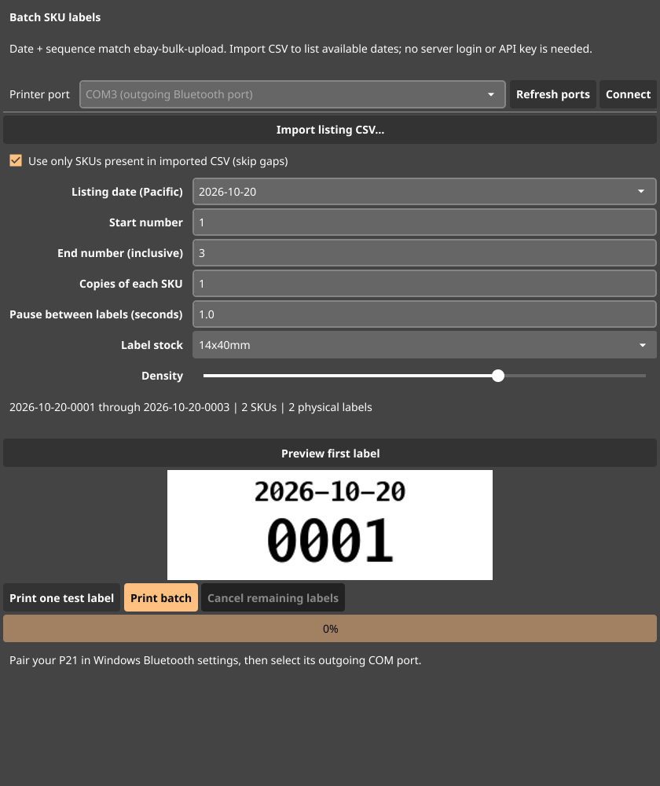

# Nelko SKU Label Printer

A Windows desktop batch-label app for the Nelko P21/P22, based on [TylerCode/Fyne-P21-Print](https://github.com/TylerCode/Fyne-P21-Print), MIT licensed. Matches the `YYYY-MM-DD-NNNN` packing SKUs generated by riotholdings/ebay-bulk-upload. No OpenAI key or server credentials are needed.

## Download and use on Windows

1. Download the Windows ZIP from [Releases](https://github.com/riotholdings/nelko-sku-label-printer/releases), extract it, and open **nelko-sku-label-printer.exe**. This is an unsigned community app; Windows may flag it as unrecognized. Source and build workflow are public.
2. Turn on the P21 and pair it in **Windows Settings > Bluetooth & devices**. Close the Nelko phone app so it does not hold the connection.
3. In **More Bluetooth settings > COM Ports**, find the printer's **outgoing** serial port (for example COM3). Select or enter it in the app and click **Connect**. The app uses the upstream Bluetooth SPP/serial transport, not a Windows paper printer driver. If your firmware exposes no serial port, this transport cannot connect; Bluetooth Low Energy-only models are not supported.
4. Choose your **listing date**, **start number**, and **end number**. The date dropdown covers nearby days; type any real YYYY-MM-DD date for other days.
5. Select the label stock matching your roll (default 14x40mm). Click **Preview first label**, then **Print one test label** to confirm alignment and darkness.
6. Click **Print batch** and confirm the count. Example: October 20, start 1, end 25 sends exactly `2026-10-20-0001` through `2026-10-20-0025`, one per label.

Each label shows the complete date on one line and the padded sequence on a larger, separate line. Together they are the exact SKU; no number is cut off. Sequence numbers greater than 9999 keep all digits. The app does not reserve or create listings on your server: use the same listing date and numbers already assigned there. Pacific date is the default even on Windows computers set to another timezone.

## Import a listing CSV (recommended)

Click **Import listing CSV...**, select the CSV downloaded from ebay-bulk-upload, and choose a date from the imported dates. The app reads the **Custom label (SKU)** column, fills that day's minimum/maximum numbers, deduplicates SKUs, and prints only actual matching SKUs when **Use only SKUs present in imported CSV** is checked. Thus cancelled-batch gaps do not print unwanted labels. It understands quoted CSV, embedded description line breaks and a UTF-8 BOM. Old PACK-/CARD- SKUs are ignored with a count. Import is local; nothing is uploaded.

For several export files from the same day, either print each file's actual SKUs separately or use manual range mode for a known uninterrupted range. CSV import replaces the currently imported file; it does not merge files automatically.

## Queue, copies and interruption

- Copies apply to every SKU; physical count is shown before printing. A test label is an extra copy of the first selected SKU.
- The queue sends one label at a time with a default 1-second gap; adjust from 0.2 to 60 seconds if the printer needs longer. Up to 100,000 physical labels per job, 1-100 copies per SKU; split larger runs.
- Cancel stops future sends after the current transmission. Data already buffered in the printer may still print.
- A transport error stops the queue. It never automatically retries a possibly printed label. Check the last physical label and adjust the start number before resuming.
- **Sent** means accepted by the serial transport, not verified paper output. The P21 transport does not acknowledge individual labels. Paper jams, out-of-label conditions or a disconnected radio can require a manual check even when a write succeeded.

## Build

Go 1.24.2+ and the Fyne native build prerequisites are required. On Windows, install a compatible MinGW-w64 GCC toolchain and put gcc on PATH, then:

```powershell
go test -tags ci ./...
$env:CGO_ENABLED="1"
go build -trimpath -ldflags="-H windowsgui" -o nelko-sku-label-printer.exe ./cmd/sku-label-printer
```

The **Windows SKU Printer** Actions workflow runs tests, builds the native Windows executable and publishes its ZIP to Releases on main updates. For Linux development install the Fyne OpenGL/X11 prerequisites, then `go run ./cmd/sku-label-printer`. Core tests run headlessly using `go test -tags ci ./...`.

## Upstream and hardware validation

The upstream application and its image/text/designer command remain in `cmd/nelko-print`; see [UPSTREAM-README.md](UPSTREAM-README.md). The new app is `cmd/sku-label-printer`. Bluetooth/TSPL communication and supported stock sizes come from upstream; software tests and build success cannot substitute for a physical test on your particular printer/firmware. Print a test label first. This project is not affiliated with Nelko.

Original copyright and MIT license are retained in LICENSE. Upstream source snapshot: `be650af7dbc182fa7f240f1e44b7edef0ac48c60` (tree, main as inspected October 20, 2026).

## App preview


